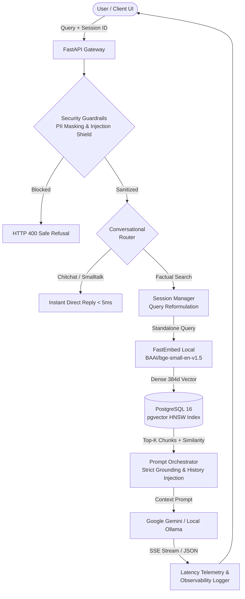

# OmniRAG: Enterprise-Grade AI Document Intelligence Platform

[](https://www.python.org/)
[](https://fastapi.tiangolo.com/)
[](https://github.com/pgvector/pgvector)
[](https://ai.google.dev/)
[](https://www.docker.com/)
[](tests/)

OmniRAG is a production-engineered Retrieval-Augmented Generation (RAG) platform designed for strict enterprise document intelligence. It combines hybrid dense semantic search using **PostgreSQL 16 + pgvector (HNSW indexing)** with conversational memory, multi-lingual voice dictation, security guardrails, and real-time observability telemetry.

---

## Architecture Overview



---

## Key Engineering Capabilities

### 1. PostgreSQL 16 + pgvector HNSW Hybrid Vector Store
- **Sub-30ms Vector Search**: Uses Hierarchical Navigable Small World (`HNSW`) cosine distance index (`vector_cosine_ops`) over 384-dimensional dense embeddings (`BAAI/bge-small-en-v1.5`).
- **Idempotent Upserts**: SHA-256 chunk hashing prevents duplicate rows during re-indexing.
- **JSONB Metadata Filtering**: Filter chunks by source filename, page index, and custom metadata attributes directly in SQL.

### 2. Multi-Turn Conversational Memory & Query Reformulation
- **Stateful In-Memory Session Store**: Thread-safe `SessionManager` with configurable TTL expiration.
- **Anaphora & Pronoun Resolution**: `QueryReformulator` rewrites ambiguous follow-up questions (e.g., *"And what about the Caution Deposit?"*) into self-contained search vectors using prior turns without incurring extra LLM latency before retrieval.
- **Session Reset API**: Dedicated endpoint (`DELETE /api/sessions/{session_id}`) to clear conversation history.

### 3. Visual Citation Inspector (Slide-Over Drawer)
- **Verbatim Grounding**: Every answer features clickable inline citation badges (`📄 document.md • p.1`) and verified source cards.
- **Detailed Inspection Drawer**: View cosine similarity percentages, page indices, chunk IDs, character offsets, and the verbatim snippet text.
- **Interactive Follow-ups**: Pre-fills the chat input with targeted questions referencing the inspected chunk.

### 4. Enterprise Security Guardrails & PII Sanitization
- **Automatic PII Redaction**: Regex engines mask Social Security numbers, credit cards, emails, and phone numbers before ingestion and retrieval.
- **Prompt Injection Defense**: Evaluates inputs against adversarial pattern matrices (system prompt leak attempts, jailbreaks, role overrides).

### 5. Multilingual Support & Voice Dictation
- **Multilingual Grounding**: Generates answers in the exact language or dialect requested by the user (Hindi, Hinglish, Spanish, French, German, English).
- **Web Speech API**: Integrated voice-to-text dictation and text-to-speech listening capabilities.

### 6. Production Observability & Telemetry Decomposition
- High-resolution monotonic timers measure:
  - **Retrieval Latency**: Vector store query and cosine filtering duration (~15–40ms).
  - **Generation Latency / Time to First Token (TTFT)**.
  - **Total Round-Trip Time (RTT)**.
- Telemetry pill rendered below every assistant response: `⚡ 850ms (Retrieval: 18ms | LLM: 832ms) • 100% Grounded • pgvector HNSW`.

---

## Tech Stack

| Layer | Component | Description |
|---|---|---|
| **API Framework** | FastAPI (Python 3.12) | Asynchronous REST gateway with SSE streaming |
| **Vector Database** | PostgreSQL 16 + pgvector | HNSW vector indexing with cosine distance |
| **Embeddings** | FastEmbed Local | Lightweight ONNX `BAAI/bge-small-en-v1.5` embeddings |
| **Primary LLM** | Google Gemini Flash Lite | Ultra low-latency cloud inference via SDK |
| **Local LLM** | Ollama (`deepseek-r1`, `llama3.2`) | Zero-cloud fallback via Docker container |
| **Document ETL** | PyMuPDF + Custom Chunker | Recursive character text chunking with token overlap |
| **Frontend** | Vanilla ES6+ & CSS3 | Dark-mode glassmorphic UI with marked.js |

---

## Quickstart Guide

### 1. Prerequisites
- Docker & Docker Compose
- Python 3.12+

### 2. Environment Setup
```bash
git clone https://github.com/your-username/ai-document-rag.git
cd ai-document-rag

# Copy environment template
cp .env.example .env

# Edit .env with your Gemini API key (or use local Ollama)
# GEMINI_API_KEY=your_key_here
```

### 3. Start Infrastructure
```bash
docker compose up -d
```
This starts:
- PostgreSQL 16 with pgvector on port `5432`
- Ollama runtime on port `11434`

### 4. Install Dependencies & Run
```bash
python3 -m venv .venv
source .venv/bin/activate
pip install -r requirements.txt

# Start FastAPI server
python server.py
```
Open your browser at **`http://localhost:8000`** to access the interactive studio.

---

## REST API Reference

### Health & Stats
```http
GET /health
```
```json
{
  "status": "healthy",
  "total_indexed_chunks": 56,
  "vector_store_type": "pgvector (PostgreSQL HNSW)",
  "llm_provider": "Gemini (gemini-flash-lite-latest)"
}
```

### Document Ingestion (Async 202)
```http
POST /api/documents/upload
Content-Type: multipart/form-data

file=@data/greenwood_high_school_rulebook.md
```

### Retrieval Query
```http
POST /api/query
Content-Type: application/json

{
  "query": "What are the late fee penalties at Greenwood High School?",
  "top_k": 4,
  "min_similarity": 0.35,
  "session_id": "session_abc123"
}
```

### Real-Time Streaming
```http
POST /api/query/stream
Content-Type: application/json

{
  "query": "What are the withdrawal fee refund slabs?",
  "top_k": 4,
  "session_id": "session_abc123"
}
```

### Reset Conversational Memory
```http
DELETE /api/sessions/{session_id}
```

---

## Running Automated Tests

The test suite covers end-to-end API flows, conversational routing, memory reformulation, security guardrails, streaming, and pgvector operations:

```bash
pytest tests/ -v
```

Output:
```text
tests/test_api.py .                                                      [  8%]
tests/test_conversational.py ..                                          [ 25%]
tests/test_conversational_memory.py ....                                 [ 58%]
tests/test_evaluation_and_guardrails.py .                                [ 66%]
tests/test_hybrid_search.py .                                            [ 75%]
tests/test_pgvector.py .                                                 [ 83%]
tests/test_streaming.py .                                                [ 91%]
tests/test_suggestions.py .                                              [100%]

======================== 12 passed in 14.8s ========================
```

---

## License

MIT License. Designed and engineered for production document intelligence.
