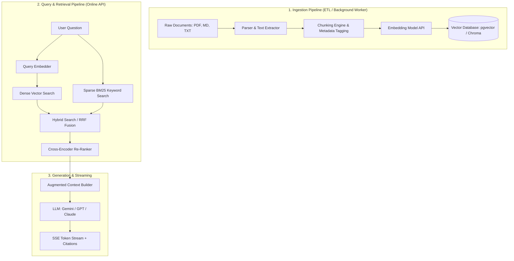

# Production RAG Engineering Roadmap
> **Goal:** Master enterprise-grade AI Document Q&A (Retrieval-Augmented Generation) backend engineering from scratch to production.

---

## High-Level Architecture

---

## Learning Phases & Milestones

- [ ] **Phase 1: Bare-Metal RAG Core (Under the Hood)**
  - [x] **1.1 Parsing & Chunking Strategies**
    - Raw text extraction from documents (`pymupdf` / Markdown / Text).
    - Character vs token-based chunking concepts.
    - Recursive splitting (`\n\n` -> `\n` -> sentences -> words) and chunk overlap.
    - Metadata tagging (`source`, `page`, `chunk_id`, `char_start`, `char_end`).
  - [x] **1.2 Embeddings & Similarity Math**
    - High-dimensional vector generation via Embedding models (`fastembed` / `bge-small-en-v1.5`).
    - Cosine similarity vs dot product calculation with pure NumPy.
    - Vector $L_2$ normalization (why normalized dot product $\equiv$ cosine similarity).
  - [x] **1.3 Local Vector Store**
    - Indexing chunks and fast similarity search with ChromaDB (HNSW index).
    - Persistent disk storage and collections.
    - Idempotent upserts and source-based document deletions.
    - Metadata filtering (`where={"source": ...}`).
  - [x] **1.4 Prompt Orchestration & Grounded Generation**
    - Designing strict anti-hallucination system prompts.
    - Token budgeting and context window management.
    - Grounding boundaries and citations enforcement.
    - Provider abstraction (Gemini / Mock / local).
  - [x] **Milestone 1:** A clean, zero-framework CLI tool (`cli.py`) that indexes a document and answers questions with accurate source citations.

---

- [ ] **Phase 2: Production Backend Architecture (APIs & Storage)**
  - [x] **2.1 REST API Design**
    - Building service endpoints with FastAPI for upload, status check, and query.
    - Pydantic v2 validation models and latency instrumentation.
  - [x] **2.2 Async Document Ingestion**
    - Offloading parsing and embedding generation to background tasks / worker threads.
    - Tracking ingestion state (`PENDING`, `PROCESSING`, `INDEXED`, `FAILED`).
  - [x] **2.3 Enterprise Vector DB with `pgvector` (PostgreSQL)**
    - Spinning up PostgreSQL with `pgvector` in Docker (`rag_pgvector`).
    - Schema design: relational metadata + JSONB alongside vector(384) columns.
    - Indexing optimization: HNSW index with cosine distance operator (`<=>`).
  - [x] **2.4 Real-time Streaming**
    - Server-Sent Events (SSE) streaming output token-by-token with latency under 1s Time-To-First-Token (TTFT).
    - Structured SSE protocol: `sources` event followed by incremental `token` events.
  - [x] **Milestone 2:** Dockerized backend service with `pgvector` supporting asynchronous document uploads and streaming Q&A.

---

- [ ] **Phase 3: Advanced Retrieval Optimization (Interview & Production Ready)**
  - [x] **3.1 Hybrid Search (Dense + Sparse)**
    - Combining dense semantic vector search with sparse full-text search (BM25Okapi).
    - Reciprocal Rank Fusion (RRF) algorithm with $k=60$ to merge ranking scores.
  - [x] **3.2 Re-Ranking Pipeline**
    - Multi-stage retrieval: Fetching candidates and passing through Cross-Encoder model (`FlashRank`).
  - [x] **3.3 Metadata Filtering & Multi-Tenancy**
    - Partitioned queries by source document and JSONB metadata fields.
  - [x] **3.4 Conversational Memory & Query Reformulation**
    - Multi-turn conversation sessions and contextual pronoun resolution.
  - [x] **Milestone 3:** Advanced retrieval engine demonstrating measurable improvements on keyword matching, semantic fusion, and multi-turn questions.

---

- [x] **Phase 4: Evaluation, Observability & Hardening**
  - [x] **4.1 Automated Evaluation (The RAG Triad)**
    - Objective scoring for Context Relevance, Faithfulness/Groundedness, and Answer Relevance (`src/evaluation.py`).
  - [x] **4.2 Security Guardrails & Defense**
    - Prompt injection detection and defense (`src/guardrails.py`).
    - PII data masking (redacting emails, phone numbers, credit card numbers).
  - [x] **4.3 Full-Featured Web UI Studio**
    - Single-page application in `/static` served by FastAPI at root `/`.
    - Drag-and-drop document upload with real-time progress bar.
    - SSE streaming chat with typing animation and collapsible citation cards.
  - [x] **Milestone 4:** Complete production-grade RAG system with PostgreSQL/pgvector in Docker, FastAPI backend, Hybrid Search, Cross-Encoder Re-Ranking, Guardrails, and interactive UI.

---

## Final Project Status: 100% Complete & Verified ✓

## Execution Rule
We will proceed strictly step-by-step. Each sub-step will be implemented, explained, and verified. We only advance to the next step once you confirm completion.
